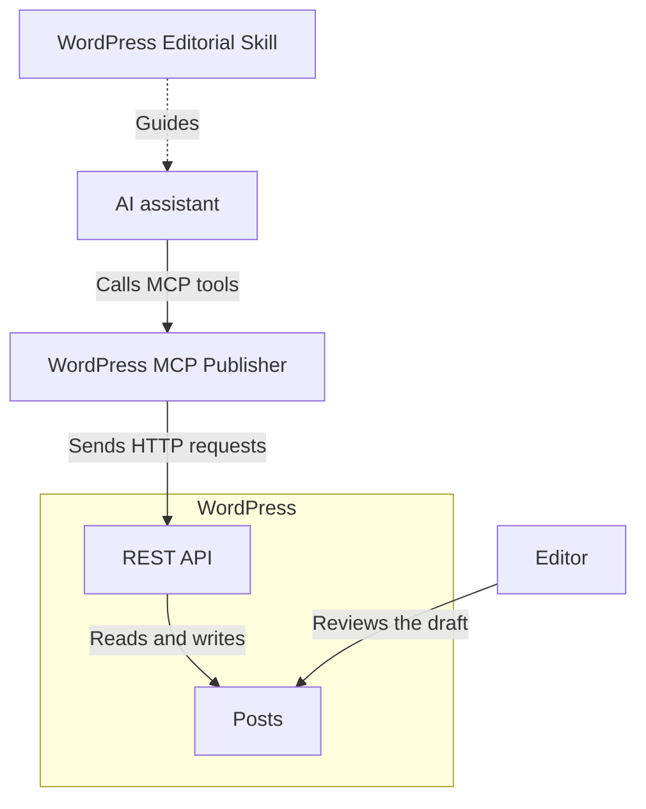

# WordPress Editorial Skill — from a finished article to a draft ready for review

*Portfolio case study · Rubens Lima · November 2026*

[Leia em português](README.md)

I started with a recurring task in my work as a content creator. Once an article was written, I still had to prepare it in WordPress, check its title and URL, and look for an existing post that matched it. I wanted to automate that handoff while keeping the publishing decision with the editor.

## An open integration and an editorial workflow

I started by building **WordPress MCP Publisher**, a server that lets assistants compatible with the Model Context Protocol (MCP) work with WordPress through its native REST API. I published the project on GitHub under the MIT License. When Agensi contacted me, I saw an opportunity to turn the editorial workflow into a product of its own.

The Publisher provides operations such as searching posts and saving drafts. **WordPress Editorial Skill** defines how the assistant uses those operations. It checks access, validates the article, searches for duplicates, saves a draft, and reports the result. WordPress enforces the connected account's permissions. Other workflows can use the same integration, and the editorial rules can evolve independently of the WordPress connection.

## System architecture

In the MVP, Codex applied the Skill's rules in the client. The Publisher received MCP calls and executed the operations through the REST API. WordPress enforced the connected account's permissions, and the editor could open the draft for review.

The MVP documentation describes input validation, duplicate checks, and draft confirmation. The Publisher's public code shows how the server registers the tools and communicates with the REST API. [MCP server](https://github.com/rubensplima/wordpress-mcp-publisher/blob/v0.4.1/src/server.js) · [REST API client](https://github.com/rubensplima/wordpress-mcp-publisher/blob/v0.4.1/src/wordpress.js)

## Prototyping in LocalWP

On November 14, 2026, I defined the scope of the first delivery. The prototype took a finished article and created a draft ready for review. I used Codex CLI as the reference client, Publisher v0.4.0, and an isolated WordPress installation in LocalWP. I tested with an account assigned the Editor role.

The workflow first checked the account and article details. It then searched for the title and the slug, the part of the URL that identifies the post. A match stopped the workflow before creation. A successful write returned the post ID and a `draft` status. The editor decided when to publish.

## Local WordPress tests

| Scenario | Result recorded in local WordPress |
| --- | --- |
| Submit a new article | A draft was created and confirmed in a subsequent read. |
| Reuse an existing slug | Creation stopped with `duplicate_slug`. |
| Reuse an existing title | Creation stopped with `duplicate_title`. The test title included accented characters. |

The duplicate check was particularly important on resubmission. The same workflow that saved a new article could also detect when the article was already in WordPress. The returned ID gave the editor a way to locate the draft and inspect what had been saved.

## MVP validation in staging

On November 26, 2026, I validated Skill v0.1.0 in an isolated WordPress staging site using the v0.4.2 staging connector. I ran simulations in Codex CLI and executed the complete WordPress workflow in Codex desktop.

| Scenario | Result recorded in staging |
| --- | --- |
| Article submitted without a slug | The draft was confirmed by reading it back. On resubmission, the title search found only that post and stopped before another write. |
| Article submitted with a slug | The draft was confirmed with the requested slug and the original content. A follow-up slug search returned only that post. |
| Complete workflow in Codex desktop | The draft was saved and confirmed by reading it back. On resubmission, the title and slug searches found the same post and stopped before another write. |

The validation covered sequential resubmissions. Search and creation are separate operations, so simultaneous submissions were outside the scope of the tests.

## From validation to launch

I submitted WordPress Editorial Skill to Agensi, where it was approved and listed in the marketplace. This case study documents the workflow for creating and reviewing drafts. The marketplace listing records the product launch. Time savings, adoption, and sales still need to be measured.

- [WordPress Editorial Skill on Agensi](https://www.agensi.io/skills/wordpress-editorial-skill)
- [WordPress MCP Publisher on GitHub](https://github.com/rubensplima/wordpress-mcp-publisher)
- [Publisher v0.4.0 version record for the prototype](https://github.com/rubensplima/wordpress-mcp-publisher/blob/b732d1a554e42b2c9f6d453e067a55b6c004d9b8/package.json)
