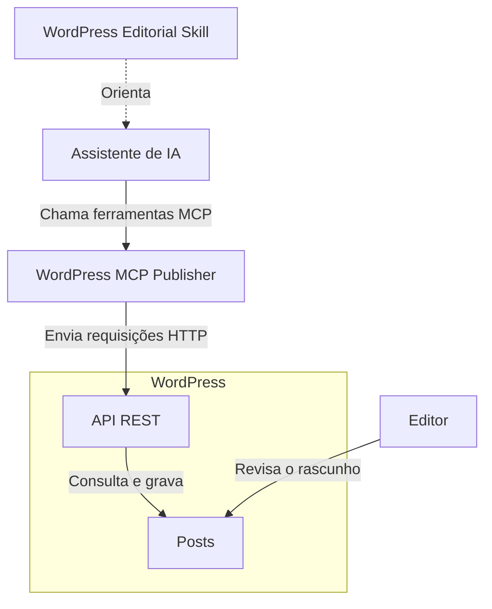

# WordPress Editorial Skill — do artigo pronto ao rascunho revisável

*Estudo de caso de portfólio · Rubens Lima · Novembro de 2026*

[Read in English](README.en.md)

O ponto de partida foi uma etapa recorrente do meu trabalho como criador de conteúdo. Depois de escrever um artigo, eu ainda precisava prepará-lo no WordPress, conferir o título e o endereço da página e verificar se já existia um post correspondente. Queria automatizar essa passagem e manter a decisão de publicar sob controle editorial.

## Uma infraestrutura pública e um fluxo editorial

Comecei pelo **WordPress MCP Publisher**, um servidor que permite a assistentes compatíveis com o Model Context Protocol (MCP) operar o WordPress por meio da API REST nativa. Publiquei o projeto no GitHub sob licença MIT. O contato da Agensi abriu a oportunidade de transformar o fluxo editorial em um produto próprio.

O Publisher oferece operações como consultar posts e gravar rascunhos. A **WordPress Editorial Skill** descreve como o assistente conduz a tarefa: verificar o acesso, validar os dados do artigo, buscar possíveis duplicatas, gravar o rascunho e informar o resultado. O WordPress aplica as permissões da conta conectada. Com essa divisão, a mesma integração pode servir a outros fluxos, e as regras editoriais podem evoluir sem exigir mudanças na conexão com o site.

## Arquitetura técnica

No MVP, o Codex aplicava as regras da Skill no próprio cliente. O Publisher recebia as chamadas MCP e executava as operações pela API REST. O WordPress aplicava as permissões da conta conectada, e o editor podia abrir o rascunho para revisão.

A documentação do MVP descreve a validação de entradas, as consultas de duplicidade e a confirmação do rascunho. O código público do Publisher permite verificar o registro das ferramentas e a comunicação com a API REST. [Servidor MCP](https://github.com/rubensplima/wordpress-mcp-publisher/blob/v0.4.1/src/server.js) · [Cliente da API REST](https://github.com/rubensplima/wordpress-mcp-publisher/blob/v0.4.1/src/wordpress.js)

## O protótipo no LocalWP

Em 14 de novembro de 2026, defini o escopo da primeira entrega. O protótipo partia de um artigo pronto e terminava com um rascunho disponível para revisão. Usei o Codex CLI como cliente de referência, o Publisher v0.4.0 e uma instalação isolada do WordPress no LocalWP. Uma conta com perfil de Editor permitiu testar o fluxo em condições próximas às do uso editorial.

A sequência começava pela verificação da conta e dos dados do artigo. Em seguida, o fluxo consultava o título e o slug, que é o trecho da URL usado para identificar o post. Se houvesse uma correspondência, a criação era bloqueada. A criação aprovada devolvia o ID do post e o status `draft`. A publicação ficava a cargo do editor.

## Os testes no WordPress local

| Cenário | Resultado registrado no WordPress local |
| --- | --- |
| Enviar um artigo novo | Rascunho criado e confirmado em uma consulta posterior. |
| Repetir o slug de um artigo existente | A criação foi bloqueada com `duplicate_slug`. |
| Repetir o título de um artigo existente | A criação foi bloqueada com `duplicate_title`, em um teste que usou um título com acentuação. |

A checagem de duplicidade importava especialmente quando alguém repetia o envio. O mesmo fluxo que gravava um artigo novo também reconhecia quando o trabalho já estava no WordPress. O ID devolvido dava ao editor uma forma de localizar o rascunho e conferir o que havia sido gravado.

## Validação do MVP em homologação

Em 26 de novembro de 2026, validei a versão 0.1.0 da Skill em um WordPress isolado, com o conector de homologação v0.4.2. Usei o Codex CLI para simulações e o Codex desktop para executar o fluxo completo com o WordPress.

| Cenário | Resultado registrado em homologação |
| --- | --- |
| Artigo sem slug informado | O rascunho foi confirmado por leitura. Na repetição, a busca pelo título encontrou somente esse post e encerrou o fluxo antes de outra escrita. |
| Artigo com slug informado | O rascunho foi confirmado com o slug solicitado e o conteúdo preservado. Uma nova busca por slug retornou somente esse post. |
| Fluxo completo no Codex desktop | O rascunho foi gravado e conferido por leitura. No reenvio, as buscas por título e slug encontraram o mesmo post, e o fluxo encerrou antes de outra escrita. |

A validação cobriu reenvios sucessivos. Como a busca e a criação são operações separadas, o comportamento em envios simultâneos ficou fora do escopo dos testes.

## Do teste ao lançamento

A WordPress Editorial Skill foi submetida, aprovada e disponibilizada no marketplace da Agensi. A entrega demonstrada neste estudo de caso é o fluxo de criação e revisão de rascunhos. A presença no marketplace registra o lançamento do produto. O impacto em tempo de trabalho, a adoção e as vendas ainda precisam de dados para ser avaliados.

- [WordPress Editorial Skill na Agensi](https://www.agensi.io/skills/wordpress-editorial-skill)
- [WordPress MCP Publisher no GitHub](https://github.com/rubensplima/wordpress-mcp-publisher)
- [Registro da versão 0.4.0 do Publisher usada como base do protótipo](https://github.com/rubensplima/wordpress-mcp-publisher/blob/b732d1a554e42b2c9f6d453e067a55b6c004d9b8/package.json)
