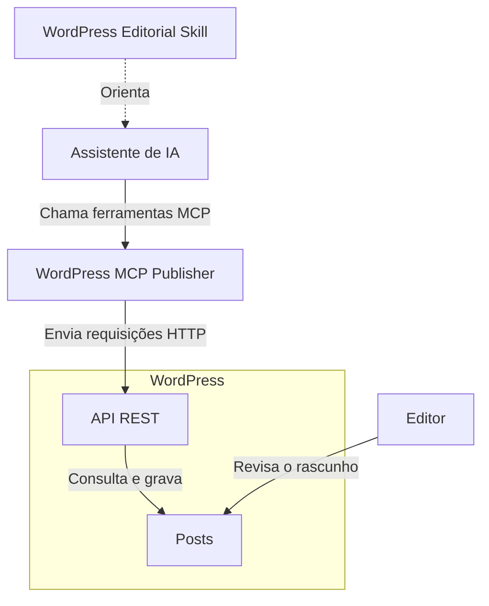

# WordPress Editorial Skill

## De um problema editorial a um produto comercial de IA

*Rubens Lima · Estudo de caso · Novembro de 2026*

Desenvolvimento de produto · Engenharia de IA · Model Context Protocol (MCP) · Código aberto

### 01. Resumo executivo

Depois de escrever um artigo, eu ainda precisava prepará-lo no WordPress, conferir o título e o endereço da página e verificar se já existia um post correspondente. Dessa necessidade surgiram dois projetos. O primeiro foi o WordPress MCP Publisher, a integração de código aberto que permite a um assistente operar o WordPress. O segundo foi a WordPress Editorial Skill, que transforma essas operações em um fluxo editorial com regras de validação, prevenção de duplicatas e revisão humana.

A primeira versão do produto recebeu um artigo pronto e o transformou em um rascunho verificável. Em homologação, o Codex desktop criou o post, confirmou o conteúdo salvo e localizou o mesmo rascunho quando recebeu o artigo novamente. A Agensi aprovou e disponibilizou a Skill no marketplace. Esses marcos estabelecem o que foi entregue e onde o fluxo foi validado. Adoção, vendas e economia de tempo ainda precisam ser medidas.

### 02. O problema original

No meu trabalho como criador de conteúdo, escrever o artigo e prepará-lo para publicação eram etapas distintas. A segunda incluía transferir o texto, conferir o título, ajustar o slug e localizar o post no painel. Quando eu retomava um artigo já enviado, precisava saber se havia um rascunho para revisar antes de criar outro.

A automação precisava respeitar esse ponto de passagem. O assistente receberia um artigo existente e devolveria um resultado que eu pudesse conferir no WordPress. Defini três critérios concretos para essa primeira entrega. O texto deveria chegar ao destino correto, ficar em `draft` e ter seu ID confirmado por uma consulta de leitura. Ao reenviar o mesmo artigo, eu deveria encontrar o post existente.

### 03. Concepção da solução

Comecei pela comunicação com o WordPress. O Publisher expõe um conjunto de ferramentas pelo Model Context Protocol, ou MCP. Um cliente compatível pode consultar posts e criar rascunhos usando essas ferramentas. Publiquei o projeto no GitHub para que a integração pudesse ser examinada e reutilizada.

A Skill acrescentou a lógica de trabalho editorial. A tarefa tinha uma ordem que afeta o resultado. O assistente valida o material, confirma a conta e o site de destino, pesquisa título e slug, cria um rascunho quando as consultas permitem e lê o registro gravado. Se encontra um post correspondente, apresenta o conflito e informa qual post já existe. Quando o artigo chega sem slug, o fluxo pode seguir com a verificação pelo título.

Essa divisão permitiu manter a integração como projeto independente. A sequência editorial pôde ser desenvolvida e testada à parte, usando um contrato de operações do Publisher.

### 04. Arquitetura técnica

O Codex aplica as instruções da Skill no cliente. O Publisher recebe as chamadas MCP e as traduz em operações na API REST. O WordPress aplica as permissões da conta conectada e mantém o registro do post. O editor pode abrir esse registro diretamente no painel para revisar o texto.

Na criação de um rascunho, a leitura posterior fecha o fluxo. A resposta da ferramenta de escrita dá um ID para consulta. A consulta confirma se o post existe e se o status e o conteúdo correspondem ao esperado. Esse retorno dá ao editor um ponto de partida concreto para a revisão. [Servidor MCP público](https://github.com/rubensplima/wordpress-mcp-publisher/blob/v0.4.1/src/server.js) · [Cliente da API REST](https://github.com/rubensplima/wordpress-mcp-publisher/blob/v0.4.1/src/wordpress.js)

### 05. Trajetória de desenvolvimento

| Marco | Decisão ou entrega |
| --- | --- |
| Publisher público | A integração começou como ferramenta para o meu fluxo editorial e ganhou um repositório aberto. |
| 13 de novembro de 2026 | A conversa com a Agensi esclareceu como uma Skill poderia ser distribuída a partir de um projeto MCP público. |
| 14 de novembro de 2026 | Defini o escopo do MVP e escolhi o Publisher 0.4.0 como base do protótipo em LocalWP. |
| Reta final de novembro | O Publisher público recebeu a versão 0.4.1 de manutenção. Em paralelo, a Skill passou a usar o contrato do conector 0.4.2 e foi validada em um WordPress de homologação. |
| 26 de novembro de 2026 | A validação do fluxo completo do MVP 0.1.0 e a disponibilização da Skill na Agensi foram registradas. |

A escolha do LocalWP permitiu verificar, com uma conta de Editor, o comportamento inicial de criação e os conflitos por título e slug. A homologação acrescentou o cliente desktop e o conector autenticado. Ela reproduziu a sequência que um usuário seguiria para entregar um texto pronto e recuperar o rascunho no WordPress. [Registro do Publisher 0.4.0](https://github.com/rubensplima/wordpress-mcp-publisher/blob/b732d1a554e42b2c9f6d453e067a55b6c004d9b8/package.json) · [Release pública 0.4.1](https://github.com/rubensplima/wordpress-mcp-publisher/releases/tag/v0.4.1)

### 06. Segurança e controle editorial

A integração lida com duas perguntas antes da escrita. Quem está conectado, e em qual WordPress a operação vai ocorrer? A Skill verifica a identidade e o destino. A autenticação da conexão MCP é tratada pelo cliente e pelo servidor. As permissões sobre os posts continuam a cargo do WordPress. As credenciais ficam nos mecanismos de autenticação usados pela integração.

O limite editorial é o status `draft`. A Skill cria um rascunho e o editor decide quando publicar. Se a resposta da criação for inconclusiva, o procedimento é consultar o WordPress antes de considerar uma nova escrita. Assim, um resultado incerto pode ser investigado sem repetir automaticamente a operação que talvez já tenha criado o post.

A manutenção do Publisher público 0.4.1 fixou versões de dependências, incluiu um lockfile e colocou o endpoint MCP em modo de manutenção por padrão. A release registra que a auditoria de dependências daquela instalação reportou zero vulnerabilidades. No conector 0.4.2, os testes observaram a continuidade de sessões OAuth em homologação e produção. A continuidade foi conferida por chamadas autenticadas posteriores, e o mecanismo interno de renovação do token ficou fora da verificação. [Notas da release 0.4.1](https://github.com/rubensplima/wordpress-mcp-publisher/releases/tag/v0.4.1)

### 07. A oportunidade comercial

A Agensi encontrou o Publisher ao pesquisar projetos MCP públicos relacionados à publicação no WordPress. O contato mostrou que uma ferramenta criada para meu uso podia servir de base para um produto voltado a outros fluxos editoriais.

A conversa também esclareceu o recorte da entrega. Caberia ao usuário configurar a conexão autorizada no próprio agente. A Skill deveria reunir o procedimento editorial e as instruções de configuração necessárias para que essa experiência fosse reproduzível. Isso transformou uma sequência que eu já entendia por conhecer a integração em uma entrega que outra pessoa poderia instalar e usar.

### 08. Desenvolvimento da Skill

O MVP 0.1.0 recebeu três elementos de entrada. Título e conteúdo eram obrigatórios, e o slug podia ser informado pelo usuário. A versão foi planejada para terminar com um rascunho verificável. Recursos como geração de artigos, agendamento, publicação, imagens e SEO avançado ficaram fora do escopo do MVP.

Antes do teste completo, usei o Codex CLI para simular situações como entrada incompleta, ferramenta ausente, destino divergente e resposta incerta depois da escrita. A descoberta da Skill no Codex também foi conferida. A execução com WordPress aconteceu no Codex desktop, conectado ao ambiente de homologação. O pacote 0.1.0 foi revisado e passou por uma verificação de instalação limpa. Assim, o teste cobriu a descoberta do pacote e o uso da Skill sobre uma conexão autorizada.

### 09. Validação e testes

| Ambiente ou cenário | Resultado registrado |
| --- | --- |
| LocalWP com Publisher 0.4.0 | Rascunho de ID 6 criado e confirmado por leitura. Os testes de repetição registraram `duplicate_slug` e `duplicate_title`. O teste de título usou acentuação. |
| Homologação 0.4.2, artigo sem slug | Rascunho de ID 8 confirmado. Na repetição, a busca por título encontrou esse post e a execução encerrou antes de outra escrita. |
| Homologação 0.4.2, artigo com slug | Rascunho de ID 9 confirmado com o slug solicitado e o conteúdo preservado. A consulta pelo slug retornou esse post. |
| Codex desktop, fluxo completo da Skill | Rascunho de ID 10 confirmado por leitura, incluindo status, slug e conteúdo. O reenvio localizou o mesmo post pelas buscas por título e slug, sem nova criação. |
| Conector 0.4.2 em produção | Chamadas específicas confirmaram a identidade da conta em uma conexão existente e demonstraram criação e atualização de um rascunho de teste. O resultado se refere ao conector. A aceitação de ponta a ponta da Skill ocorreu em homologação. |

Os testes de duplicidade cobriram execuções sucessivas. As consultas e a criação são operações separadas. O comportamento de duas gravações simultâneas ficou fora dessa validação. O caso de resposta incerta após a escrita foi exercitado em simulação.

### 10. Lançamento do produto

A WordPress Editorial Skill foi submetida, aprovada e disponibilizada na Agensi. O lançamento colocou à disposição o pacote editorial trabalhado durante o MVP. O Publisher público continuou sendo a referência para entender a integração com WordPress.

A listagem é a evidência pública de disponibilização do produto. A avaliação de uso após o lançamento depende de dados de instalação, execução e feedback dos usuários. [WordPress Editorial Skill na Agensi](https://www.agensi.io/skills/wordpress-editorial-skill) · [WordPress MCP Publisher no GitHub](https://github.com/rubensplima/wordpress-mcp-publisher)

### 11. Aprendizados

**O resultado precisa ser conferível.** Um retorno de sucesso é útil quando fornece ao editor um ID e permite confirmar o post no sistema de destino. A leitura após a escrita tornou esse critério explícito e testável.

**A ordem do fluxo faz parte do produto.** A verificação de destino vem antes da escrita. A consulta de duplicidade vem antes da criação. Quando precisei transformar minhas práticas editoriais em um procedimento utilizável por outras pessoas, essas dependências ficaram claras.

**A integração aberta tornou o trabalho encontrável.** A publicação do Publisher deu à Agensi uma referência concreta para iniciar a conversa. O desenvolvimento comercial passou então a exigir decisões próprias sobre escopo, instalação e suporte ao fluxo editorial.

### 12. Próximos passos

O primeiro ciclo após o lançamento é acompanhar o uso do fluxo. Três perguntas orientam essa coleta. Em que ponto a instalação exige ajuda? Quantos artigos enviados chegam a um rascunho confirmado? Em quais situações o editor ainda precisa corrigir título, slug ou formatação no WordPress? As respostas podem orientar melhorias e dar base a uma medição de tempo editorial.

A evolução técnica também pode avaliar a portabilidade para outros clientes, com critérios de aceitação equivalentes aos usados no Codex. A expansão das funções editoriais depende do que for observado nesse primeiro ciclo. A decisão de publicar continua com o editor.

#### Referências de trabalho

- [Repositório público do WordPress MCP Publisher](https://github.com/rubensplima/wordpress-mcp-publisher)
- [Versão pública do Publisher 0.4.1](https://github.com/rubensplima/wordpress-mcp-publisher/releases/tag/v0.4.1)
- [Listagem pública da WordPress Editorial Skill](https://www.agensi.io/skills/wordpress-editorial-skill)
- Registros internos de arquitetura e aceitação do MVP 0.1.0, conversas de validação dos conectores e correspondência de novembro de 2026.
